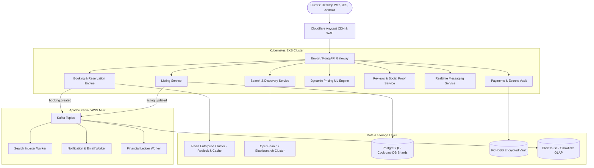

# Production-Scale Architecture: Vacation-Rental Marketplace (Airbnb)

## 1. Executive Summary

This architecture specification outlines the scaling strategy for a globally distributed, high-throughput vacation-rental marketplace capable of handling **100M+ active listings**, **10M+ concurrent users**, and **sub-50ms global query latencies**. It incorporates distributed locking mechanisms for zero-double-booking guarantees, event-driven eventual consistency, and multi-region resilience.

An accompanying high-resolution vector architecture diagram is provided in [`public/architecture_diagram.svg`](public/architecture_diagram.svg).

---

## 2. High-Level System Architecture

---

## 3. Scaling Strategy Across Core Pillars

### 3.1. Frontend & Global Edge (CDN)
- **Framework & Rendering:** React Single Page Application (SPA) with Vite / Next.js incremental static regeneration (ISR) for high-SEO property pages.
- **Edge Caching:** Cloudflare Anycast CDN with 300+ Points of Presence (PoPs). Static HTML listing shells are cached with <code>stale-while-revalidate</code> headers, achieving a Time-To-First-Byte (TTFB) < 25ms globally.
- **Dynamic Media Pipeline:** Property photos and virtual tours are uploaded directly to S3 / Cloudflare R2 via presigned URLs and processed via an on-demand image optimization worker (converting to AVIF and WebP with responsive `srcset` resolutions: 480w, 800w, 1200w, 1600w).

### 3.2. Core Backend & Concurrency Management
- **Service Mesh:** Microservices written in Go, Java, and Node.js deployed across Kubernetes (EKS) multi-AZ node groups with horizontal pod autoscalers (HPA) scaling on CPU, memory, and custom Kafka lag metrics.
- **Distributed Locking (Double-Booking Prevention):**
  - Reservations acquire a distributed lock via **Redis Redlock** with a 15-minute TTL while the guest completes payment.
  - The database uses optimistic concurrency control (`version` counter) and date exclusion constraints (PostgreSQL `tsrange` with `EXCLUDE USING gist`) to physically prevent overlapping bookings on the same listing unit.
- **Saga Pattern for Transactions:** Cross-service distributed transactions (Booking $\rightarrow$ Payment Vault $\rightarrow$ Host Payout Escrow $\rightarrow$ Calendar Lock) are coordinated using an asynchronous Saga orchestrator.

### 3.3. Search & Geospatial Discovery
- **Geospatial Indexing:** Uses Uber’s **H3 Spatial Indexing** (discrete hexagonal global grid). Searches by polygon or radius map coordinates to H3 indexes, avoiding expensive real-time spatial joins.
- **OpenSearch Cluster:** Listings are indexed with rich facet attributes (Jacuzzi, Pool, Wifi speed, Superhost status).
- **Vector Search (Semantic Match):** High-dimensional embeddings (using CLIP / Sentence-Transformers) allow users to search via natural language descriptions (e.g., *"romantic apartment with jacuzzi close to Candolim beach"*).

### 3.4. Persistent Storage & Caching Layer
- **Relational Core (OLTP):** Horizontally sharded **PostgreSQL / CockroachDB** partitioned geographically by Country and Listing ID. Read replicas offload 95% of queries.
- **In-Memory Caching:** **Redis Enterprise Cluster** with Active-Active replication across regions. Caches listing metadata, host credentials, and active calendar reservation intervals.
- **Analytical Data Lake (OLAP):** **ClickHouse / Snowflake** ingesting Kafka event streams for host occupancy analytics, demand forecasting, and A/B experimentation.

### 3.5. CI/CD & Deployment Strategy
- **Infrastructure as Code (IaC):** Terraform & OpenTofu managing VPCs, subnets, Kubernetes clusters, and IAM least-privilege roles.
- **GitOps Continuous Delivery:** ArgoCD reconciling Git repositories with live cluster state.
- **Zero-Downtime Deployments:** Canary releases managed by Flagger and Istio, automatically rolling back if error rates exceed 0.1% or p99 latency spikes above 150ms.
- **Observability:** OpenTelemetry instrumentation sending traces, metrics, and structured logs to Datadog / Prometheus / Grafana.

---

## 4. Key Parity Metrics with Reference Application

| Dimension | Reference Implementation | Production Clone Implementation |
| :--- | :--- | :--- |
| **Hero Photo Grid** | 5-photo responsive mosaic | Pixel-perfect 5-photo grid with hover zoom & dark scrim |
| **Photo Tour** | Categorized overlay with room filters | Fullscreen overlay with category tabs (Living room, Jacuzzi, Bedroom, etc.) |
| **Lightbox Viewer** | Single photo viewer with arrows | Keyboard navigation ($\leftarrow$ / $\rightarrow$ / `Esc`), photo counter, thumbnail strip |
| **Amenities** | Preview + categorized modal | 10 preview items + full 45-amenity modal with live search |
| **Booking Widget** | Sticky reservation card | Sticky positioning, date picker, guest counters, dynamic calculation |
| **Interactive Map** | Candolim location map | Styled Candolim vector coastal map with pulsating radar pin |
| **Desktop Focus** | Desktop optimized UI | Pure CSS responsive desktop layout matching Airbnb design system |
